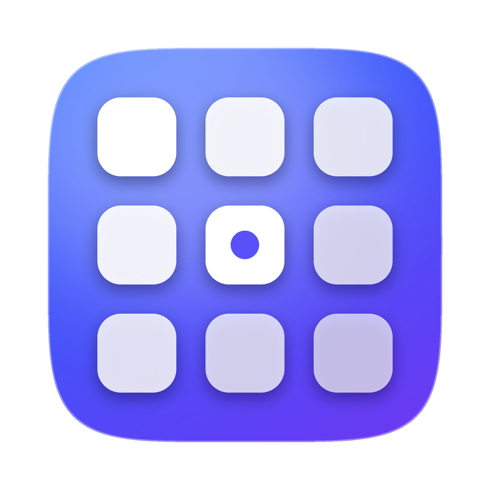

# GridOS

Полноэкранный лаунчер приложений для macOS 26 и новее, замена Launchpad. Без подписок и аккаунтов, всё хранится только на вашем Mac.

## Что умеет

- Полноэкранная сетка приложений в стиле классического Launchpad, перелистывание страниц свайпом двумя пальцами.
- Открывается **щипком четырьмя (или тремя) пальцами**, **горячей клавишей** (по умолчанию ⌃⇧Space; можно назначить любое сочетание или одиночную клавишу F1–F20), **активным углом экрана** или кликом по значку в строке меню.
- Поиск по названию, навигация стрелками и Enter.
- Перетаскивание иконок, создание папок (перетащите одно приложение на другое), переименование и удаление папок.
- **Правый клик по приложению:** открыть, показать в Finder, переименовать, скрыть из GridOS, добавить в Dock, удалить в Корзину вместе с настройками и кэшами.
- **Своя сетка:** от 4 до 12 столбцов и от 3 до 9 строк.
- Скрытые приложения и свои названия можно вернуть одной кнопкой в настройках.
- **Дополнительные папки с приложениями** помимо стандартных «Программ».
- Сортировка по названию, дате создания, дате изменения или вручную.
- Интерфейс на русском, английском и китайском языках.

## Установка

### Вариант 1: готовый `.dmg` (через GitHub)

Каждый раз, когда в ветку `main` попадают изменения, GitHub сам собирает приложение. Скачайте `GridOS-….dmg` на странице **Releases → latest**, откройте его и перетащите GridOS в «Программы».

При первом запуске macOS предупредит, что разработчик не подтверждён (приложение подписано без платного аккаунта Apple). Чтобы открыть:
**Системные настройки → Конфиденциальность и безопасность →** внизу «GridOS заблокирован…» → **«Всё равно открыть»**.

### Вариант 2: собрать у себя

1. Скачайте проект (зелёная кнопка **Code → Download ZIP**) и распакуйте.
2. Дважды кликните по файлу **`Собрать GridOS.command`**.
   - Если macOS не даёт открыть файл: правый клик → «Открыть».
   - В первый раз macOS предложит установить «инструменты командной строки» (это не Xcode, около 1–2 ГБ). Установите их и снова запустите файл.
3. Через пару минут GridOS окажется в «Программах» и запустится сам.

## Настройка

Кликните по значку сетки в строке меню правой кнопкой и выберите **«Настройки…»**. Там можно:

- задать горячую клавишу и активный угол;
- включить жест и выбрать три или четыре пальца;
- задать количество столбцов и строк;
- включить «Открывать при входе»;
- вернуть скрытые приложения и сбросить свои названия;
- добавить свои папки с приложениями.

> Если для активного угла уже назначено системное действие (Системные настройки → Рабочий стол и Dock → Активные углы), выберите в GridOS другой угол.

## Лицензия

MIT. GridOS основан на открытом проекте [Lunchpad](https://github.com/arichyx/lunchpad) (© 2026 arichyx, лицензия MIT). Исходное уведомление об авторских правах сохранено в файле `LICENSE`.
